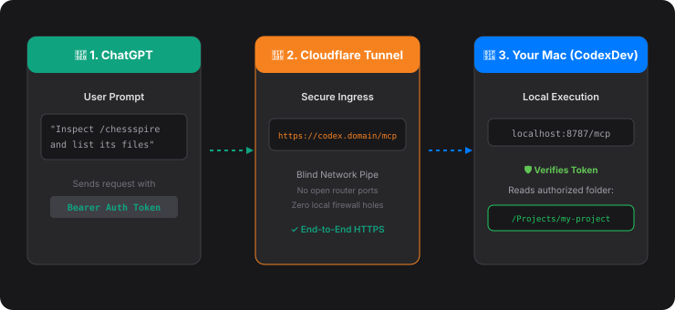
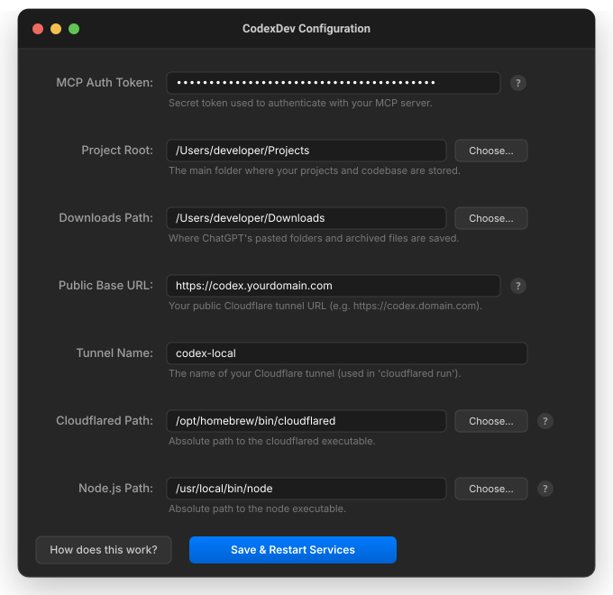
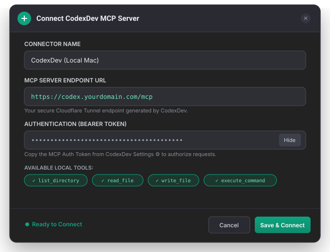

# CodexDev 🚀

<a href="https://github.com/MohamedCHAMI/CodexDev/releases/download/v1.0.0/CodexDev.dmg">
  
</a>

**CodexDev** is a native macOS application that seamlessly bridges **ChatGPT** with your local Mac file system. It acts as a secure, one-click manager for your local Model Context Protocol (MCP) server.

By running a local Node.js server and integrating with Cloudflare Tunnels natively, CodexDev empowers ChatGPT to read, write, and manage your local codebase securely—giving you a true AI co-developer experience while keeping your computer completely protected.

---

## 🌟 Why CodexDev?

Setting up a local MCP server for ChatGPT typically requires keeping terminal windows open, configuring router port-forwarding, adjusting firewall rules, and juggling complex environment variables.

**CodexDev simplifies the entire workflow with a native macOS experience:**
- 🔌 **Zero-Config Cloudflare Tunnels:** Instantly obtain a secure, public HTTPS endpoint for your local workspace without opening router ports or altering firewall configurations.
- 🛡️ **Built-in Security (The Bouncer):** Generates and enforces a private Bearer Auth Token. Only authenticated requests from ChatGPT can reach your local files.
- 🍏 **Native macOS Menu Bar App:** Operates silently in your menu bar. Start, stop, and configure your local MCP service with native SwiftUI preference panels and notifications.
- 🤖 **Smart Dependency Checking:** Automatically verifies that Node.js and Cloudflared are installed, offering single-click Homebrew installation commands if anything is missing.
- 🔒 **Local-Only Mode:** Work offline or on a trusted local network by clearing the Tunnel Name to restrict traffic to `localhost`.

---

## 🛠️ Architecture & How It Works

CodexDev acts as the coordinator between ChatGPT, Cloudflare's secure network, and your local Mac:

<p align="center">
  
</p>

1. **🧠 ChatGPT (The Brain)**: Formulates tool requests (e.g., *"Inspect project structure"* or *"Edit app.js"*) and dispatches them over HTTPS with your secret Bearer token.
2. **🌉 Cloudflare Tunnel (The Secure Conduit)**: Encrypted tunnel that routes ChatGPT's request directly down to your local Mac. It acts as a blind delivery channel without storing or inspecting your files.
3. **🤖 Local Node.js MCP Server (The Hands)**: Runs locally on your Mac via CodexDev. It validates your MCP Auth Token, bounds operations strictly within your configured **Project Root**, and carries out file operations.

---

## 🔌 Integrating CodexDev with ChatGPT (Step-by-Step)

Follow these steps to connect ChatGPT to your local development environment:

### Step 1: Configure CodexDev on your Mac

1. Launch **CodexDev.app** from your Applications folder or menu bar.
2. Click the gear icon (**⚙️ Configuration**) to open the Settings window:

<p align="center">
  
</p>

3. Configure the following fields:
   - **MCP Auth Token**: Click to generate or enter a strong secret token (e.g. `••••••••••••`). Keep this confidential.
   - **Project Root**: Click **Choose...** and select the parent folder where your codebases live (e.g., `/Users/developer/Projects`).
   - **Downloads Path**: Choose a destination folder for files exported or created by AI sessions.
   - **Public Base URL**: Enter your Cloudflare Tunnel domain (e.g. `https://codex.yourdomain.com`).
   - **Tunnel Name**: Enter your Cloudflare tunnel identifier (e.g. `codex-local`).
4. Click **Save & Restart Services**. The menu bar status will turn green (**Online**).

---

### Step 2: Add CodexDev as a Connector / MCP Server in ChatGPT

1. In ChatGPT, open **Settings** → **Connectors** (or configure **Actions** in a Custom GPT).
2. Click **Add New Connector / MCP Server**.
3. Fill in your connection details:

<p align="center">
  
</p>

- **Connector Name**: `CodexDev (Local Mac)`
- **MCP Server Endpoint URL**: `https://<your-subdomain>.yourdomain.com/mcp` *(replace with your public Cloudflare Tunnel URL)*
- **Authentication**: Select **Bearer Token** and paste the **MCP Auth Token** from CodexDev.
4. Click **Save & Connect**. ChatGPT will verify the endpoint and display the available local tools (`list_directory`, `read_file`, `write_file`, `execute_command`).

---

### Step 3: Start Pair Programming!

Once connected, you can ask ChatGPT to interact directly with your workspace:

```text
Prompt: "Inspect the /chessspire folder, analyze its package.json, and list the active dependencies."
```

ChatGPT will invoke CodexDev's MCP server securely:
1. Connects to `https://<your-domain>/mcp` using your Bearer token.
2. CodexDev verifies the token and retrieves `/chessspire` from your allowed Project Root.
3. Returns the content to ChatGPT to continue your coding workflow seamlessly.

---

## 📦 Requirements
- **macOS 12.0+** (Apple Silicon or Intel)
- **Node.js 18+** (`brew install node`)
- **Cloudflared** (`brew install cloudflared`)

*CodexDev automatically checks for these binaries on startup and provides copy-paste commands if they are missing.*

---

## 🛡️ Privacy & Security Guarantee

- **Zero Third-Party Storage**: Your code is never sent to intermediate servers or stored in third-party databases.
- **Strict Path Sandboxing**: The MCP server strictly forbids file operations outside your chosen **Project Root**.
- **Bearer Token Guard**: All unauthenticated requests are immediately rejected with `401 Unauthorized`.
- **Encrypted Ingress**: All communication travels through Cloudflare's end-to-end TLS encryption directly to your local machine.

---

## 📄 License
MIT License. Created by [Mohamed Chami](https://github.com/MohamedCHAMI).

---

## 🔁 Codex CLI bridge (use ChatGPT web from the terminal)

CodexDev can also act as the model behind **Codex CLI**, using the ChatGPT session you are already signed in to in the app.
The companion service is [`chatgpt-web-bridge`](https://github.com/MohamedCHAMI/chatgpt-web-bridge) (private).

- On launch, CodexDev opens a **local control port** on `127.0.0.1:8791` (`ChatBridgeControl.swift`). It runs ChatGPT in hidden tabs that share the app's login, so your visible chat window is never touched.
- The port exposes only fixed operations: open chat, send text, read state, show, and close. There is no arbitrary script execution, only `chatgpt.com` URLs are allowed, and every call needs the random token in `~/.chatgpt-web-bridge/app-token` (mode 600).
- If `~/Desktop/Works/Apps/chatgpt-web-bridge` is installed, CodexDev starts the bridge automatically and stops it when you quit.
- DOM selectors are read from `~/.chatgpt-web-bridge/selectors.json` on every call, so ChatGPT UI changes don't need a rebuild.

```bash
codex -p codexdev   # Codex CLI → bridge :8790 → CodexDev :8791 → ChatGPT web
```

> Automating the ChatGPT web UI is against OpenAI's terms of use. Your account may be limited or suspended. Use it at your own risk.
